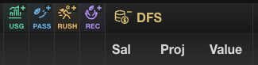
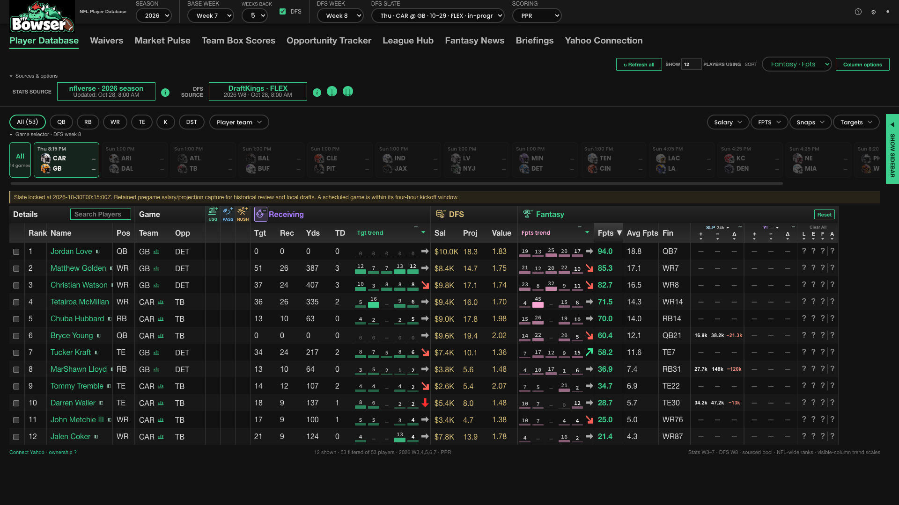

# Identifiable Player Database statistical groups

October 29, 2026 · branch `codex/stat-group-icons-20261029` · base `ae9c26d`.

Receiving now has the same reachable collapse control as every other statistical
group. Controls precede the title instead of sitting at the far edge, where the
pinned Fantasy group can cover them. Collapsed groups use a semantic SVG pictogram,
a short visible label, a plus badge, a full-name tooltip, and `aria-expanded`.
Expanded controls retain the pictogram and use a minus badge.

| Group | Pictogram | Collapsed label |
| --- | --- | --- |
| Usage | Usage bars | USG |
| Passing | Football and flight arrow | PASS |
| Rushing | Runner carrying a football | RUSH |
| Receiving | Hands catching a football | REC |
| DFS | Coins | DFS |
| Draft | Draft checklist | DFT |
| Fantasy | Trophy | FPTS |

Collapsed group rails measure 32 × 36px (formerly 18px wide). Existing data widths,
header heights, row heights, saved visibility, individual trend settings, sorting,
filters and source data remain unchanged. Draft follows its existing optional gate.

## Verification

- `npm run check`: PASS, exit 0. Includes warehouse verification, 204 main Node
  tests, Python importer tests, 300 UI tests, market and waiver suites, production
  build, production-server tests and Sites-worker tests.
- `npm run lint` and `git diff --check`: PASS.
- Regression coverage checks independent group restoration, exact 32px rail widths,
  saved state after remount, restored data widths and preserved individual trends.
  The previous 18px group expectation was updated to the intended 32px width;
  individual collapsed trends retain their existing 18px width.
- Real-data Chromium checks at 1920 × 1080 and 1280 × 900: PASS. All visible
  collapsed controls were unobscured according to DOM hit testing. Receiving works
  with mouse, Enter and Space; collapsed groups survive reload.
- Second verifier pass against the built production server: PASS. All six enabled
  groups independently collapse to exactly 32 × 36px and restore with correct
  accessible state, using ordinary browser clicks.

Local implementation is complete. Remote push, PR creation, merge and production
publication await Robert's confirmation under the supplied global AGENTS.md
launch rule. No production deployment occurred in this implementation pass.
